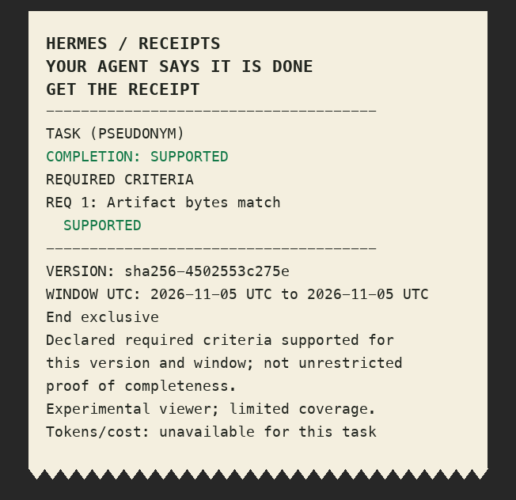
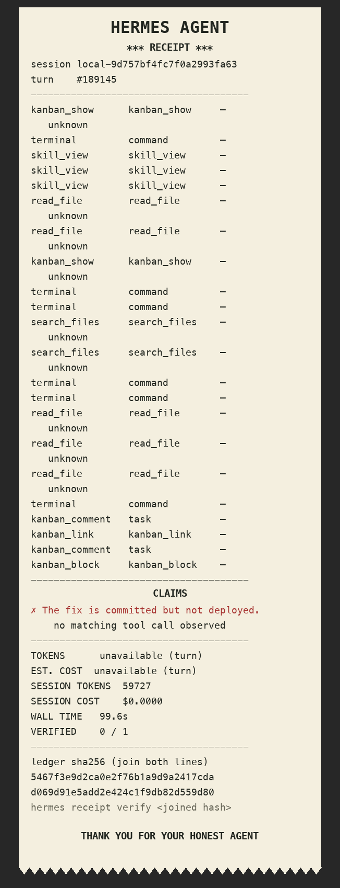

# Receipts for Hermes 🧾

**Your agent says it's done. Get the receipt.**

Receipts checks what an agent claims against observed evidence—not a session-metadata summary. The completed task is the hero: did the declared required outcomes actually happen? Individual reply claims are the evidence units; the v2 plan rolls them up to projects and per-agent/per-model evidence-backed rates, with cost and tokens only a footer.

**Available today (v1 release):** turn-by-turn thermal-paper receipts for what Hermes *observed*. Ledger hooks see each tool call; historical receipts read this profile's existing `state.db` immediately on install. No LLM calls. **v2 source under integration, not an accepted release:** a local manifest can produce a scoped task PNG, an explicitly opted-in local fleet scan can produce a grouped statement PNG, and the existing Desktop pane shows an unverified current-session preview. Independent accuracy and outcome acceptance are pending; see [PLAN-v2.md](PLAN-v2.md). Missing evidence is not proof of a lie, and a successful tool invocation alone is not proof that a task is complete.



The example is generated from actual controlled artifact bytes by `tests/create_demo.py`. It is **not** real fleet telemetry or observed USB paper. A supported completion only means *declared required criteria supported for the displayed version and window*, not unrestricted proof of completeness. [Controlled statement PNG](assets/v2-controlled-statement.png) shows the same small synthetic sample with counts only (n<10), not a population rate.



## Install / use

```bash
hermes plugins install thedavidmurray/hermes-receipts
hermes plugins enable receipts
hermes receipt last --png receipt.png
hermes receipt verify <full 64-character ledger sha256>
```

`/receipt` in CLI/Discord/Telegram renders the latest persisted **private v1** turn as text plus `MEDIA:` PNG; `/receipt <final-message-id>` selects a prior final answer. `hermes receipt last --session <id>` narrows a profile's session. Desktop has a **Receipts** pane and “Get the receipt” button for the active session: it requests a public v2 **unverified preview** only, since the pane does not accept a task manifest. Missing sessions fail closed, and requests from a prior session switch are discarded. The public Desktop SDK has no per-turn button contribution, so this does **not** patch transcript markup. Enable the Python plugin in Hermes and the Desktop component in Capabilities → Plugins; the latter alone cannot load the backend.

Experimental, local-only v2 commands (not an accepted release):

```bash
hermes receipt task --manifest /local/task.json --png /local/task.png
hermes receipt fleet --roots /explicit/local/hermes-root --start 2026-11-01T00:00:00Z --end 2026-12-01T00:00:00Z --report-db /local/report.db
hermes receipt report --report-db /local/report.db --group-by profile,model,source --png /local/statement.png
hermes receipt options            # kits, themes and field ids as JSON
```

`task` and `report` also take `--kit`, `--fields`, `--sections`, `--theme`,
`--metrics FILE` and `--from-state STATE_DB [--session-id ID]`; see
[Receipt fields, kits and themes](#receipt-fields-kits-and-themes).

Task manifests must provide a linked `done` claim, explicit required criteria and `[start,end)` UNIX observation timestamps; the optional `probes` list explicitly names an `artifact_digest` file+SHA256 or `remote_commit` local bare remote+commit. It performs actual local readbacks; it **does not** trust supplied findings/evidence, execute manifest shell commands, or run network probes. Test-bound criteria require a trusted in-process runner and remain unverified via this CLI. Only explicit `reviewed_labels` from the built-in shareable alias vocabulary are rendered; everything else becomes `Criterion N`. Rates are supported/(supported+contradicted+unverified), with not_evaluable beside the denominator; n<10 shows counts only. Unknown model/source buckets and incomplete coverage remain visible. A digest is not a signature. Fleet reads are explicitly opt-in via local CLI, never through HTTP or chat.

≤90-second demo storyboard: 0–10 task-first hook; 10–25 local manifest and required scope; 25–35 missing push stays unverified; 35–50 show real observed paper **if** hardware is present, otherwise label PNG fallback; 50–65 perform real repair and independent artifact/test/remote readback; 65–80 group statement by profile/model/source or project; 80–90 report measured accuracy and coverage limits, with tokens/cost only in the footer. A controlled artifact is labelled a controlled demo, not a sampled agent session.

Optional: `hermes receipt last --print-usb 0xVVVV 0xPPPP` uses `python-escpos>=3,<4` installed separately. It fails with a readable error if the package, printer or USB permissions are absent. This is never automatic.

The optional response stamp is **off**: `HERMES_RECEIPTS_STAMP=1` enables a legacy `🧾 n✓ m✗` suffix, not a v2 task judgment. `transform_llm_output` uses first-non-None-wins arbitration; other response transforms can conflict. The optional `pre_tool_call` gate is **observe-only by default**: setting `HERMES_RECEIPTS_GATE=block` blocks `kanban_complete` only when the *last persisted answer of the same session* has an unbacked v1 claim; missing session IDs and missing history fail open. This is a review prompt, not proof of current-turn failure, and does not approve any tool. Do not enable the legacy stamp or gate for the v2 demo; they can conflict with other transforms or block from stale answer text.

## How to read this

✓ means a matching tool call in the **same user turn** has an explicit success result. ✗ means a matching tool failed or was not recorded; it is **not proof the action never happened**. “not observed” denotes explicit subagent, CI or out-of-process work. Unknown tool results cannot be marked successful. Claims are conservative regex detections, not general natural-language entailment. In particular, a `git push` command exiting zero is evidence of command completion, *not* read-back proof that the remote branch changed; tests exiting zero are evidence of that process, not that all possible tests pass. A SHA-256 hash checks the canonical ledger rows reconstructed from `state.db`, not a signature, tamper-resistant audit log, or external attestation. No tool result bodies appear in the receipt.

The tool hook writes `tool name`, `args SHA-256`, a coarse action category, status, duration and session/turn/call ids to profile-scoped `plugin_db('receipts')`. Raw args and results are not stored there. The history reader opens **only this profile's** `state.db` in SQLite `mode=ro`, and reconstructs turns lazily from the preceding user message, assistant `tool_calls`, matching tool responses and final answer. Existing turns need no import/migration. For historical turns Hermes records neither per-turn tool duration nor per-turn usage: these are shown as unavailable, with separate **session** token/cost totals if present. Wall time is the historical user→final interval. Ledger coverage is limited by persisted tool-call history; tool calls inside `execute_code`, subagents, shell children and separate CLI jobs are not attributed to a parent unless Hermes recorded them in that parent turn.

## Disclosure (catalog rule 13)

- **Outside reads:** by default only the current profile's `state.db` read-only; an **explicit local** `receipt fleet --roots ...` opt-in also reads state DBs under the selected roots, possibly including other profiles. Message text, conversation history, tool arguments and results can contain secrets and are processed in memory. The local `task --manifest` probes explicitly named artifact files or a local bare Git remote. No browser login, implicit cross-profile scan or remote probe.
- **Stored data and retention:** v1 keeps a profile-scoped SQLite ledger and private PNGs under `plugin-data/receipts/`. Legacy v1 `/receipt`, `last` and `verify` outputs contain answer excerpts, basenames, ids and hashes: **PRIVATE, review before sharing**. The v2 fleet writes sanitized, versioned metadata and coverage to the user-chosen `--report-db`; reports and task PNGs remain at the user-chosen output path **until the user deletes them**. The current-session public pane PNG is generated in memory. Private manifest/DB files may identify sessions or tasks and should be kept separate from shareable PNGs; no automatic expiry/deletion or pseudonym map is provided. Args SHA-256 hashes in v1 may be guessable for low-entropy inputs. Do not distribute private manifest/report DB.
- **Network/telemetry/inference:** deterministic v1/v2 receipt checks initiate no network requests, metrics export, model calls, remote attestation or self-update. The separately documented, default-off `HERMES_RECEIPTS_JEV=1` classifier can send redacted in-memory context to an external API; see the opt-in disclosure below. Images use local bundled/system fonts. The Desktop pane calls only the authenticated local plugin route.
- **Shell/USB:** no shell commands from a manifest and none by default. Explicit fleet scans stream read-only transactions and may report partial/unavailable coverage; an explicit task probe may read actual file bytes or local bare Git refs. User-invoked `--print-usb` accesses the specified printer through the optional third-party `python-escpos` library and requires USB permission. Submission ACK does **not** confirm paper; without observed hardware the deliverable is PNG only.
- **Credentials:** none stored or read from another client's login. Installing from GitHub is Hermes's normal plugin manager operation, not the plugin's own network call.
- **Approvals:** never approves tools. Optional `pre_tool_call` blocking is off by default and only reviews the prior persisted answer for unbacked claims in the same session; it is not a current-turn proof. The legacy stamp is also off by default.
- **Desktop:** SDK current-session pane and authenticated profile-scoped backend route; no per-turn DOM button or fleet web API. A missing/mismatched session is rejected; the pane cannot claim supported completion without an explicit task manifest.

## Optional Jev classification — off by default

`HERMES_RECEIPTS_JEV=1` explicitly opts the receipt-generation process into an
**external API** call with sampled assistant text, tool arguments (including
completion-tool claims) and tool results. Secret assignments are masked and
`jevkit.privacy.redact` runs **before sending**. Redaction is heuristic, not
complete DLP; do not enable it for confidential sessions. Jev must be separately
available/importable; no credentials, live profiles or core are changed by this
plugin. Import/timeout/privacy/malformed-response failures fall back to
deterministic categories. Without the flag no Jev import or network call occurs.

This experimental classifier selects applicable receipt sections using the
[data-driven auto kit](kits/auto.json). It **never overrides deterministic
contradictions or other outcome verdicts**. Scores are uncalibrated, not
probabilities; judgment categories remain experimental pending independent
gold verification. `receipt_from_state` exposes `classification`/`auto_fields`
for the downstream configurable kits renderer, not a replacement renderer.
See [API, privacy, decision rules, fleet measurements and blind-verifier runner](docs/jev-fleet.md).

## Receipt fields, kits and themes

Three things a user can choose, and one thing they cannot. **Content** is a field
registry, **kits** are named field sets, **themes** are the visual layer — and the
verdict block prints for every kit, every field list and every theme.

### Verdicts are coloured by their enum, never by their text

| verdict | ink | glyph (unicode / ascii) | meaning |
|---|---|---|---|
| `supported` | green | `✓` / `[OK]` | the required readback was observed |
| `contradicted` | red | `✗` / `[X]` | an observed outcome contradicts the claim |
| `unverified` | amber | `?` / `[?]` | nothing applicable was observed; **not** a lie |
| `not_evaluable` | grey | `–` / `[-]` | no denominator for this claim |

Every verdict prints its glyph and its word, in every theme. `COMPLETION` is the
**worst** of the completion verdict and every *required* criterion — so it is green
only when all required criteria are supported, and no criterion can ever upgrade a
completion claim. In a monochrome theme a contradicted verdict is drawn as inverse
video (light text on an ink bar) so it cannot be mistaken for a supported one.
Statement counts (declared claims, and each report group) are coloured per
category, one line per verdict.

### Fields

Each field declares the source it reads; a field with no data prints `n/a` and
never a guess (`v2/fields.py`, `FIELDS`). Selectable ids: `verdict`,
`task_session_id`, `session`, `profile`, `agent`, `model`, `provider`, `turns`,
`tool_call_count`, `top_tools`, `tokens_in`, `tokens_out`, `tokens_total`, `cost`,
`cost_scope`, `duration`, `files_touched`, `claims_detected`, `verdict_per_claim`,
`evidence_locators`, `artifact_version`, `detector_version`, `matcher_version`,
`plugin_version`, `git_sha`, `receipt_hash`, `timestamp`.

Telemetry is read **read-only** (`mode=ro`, `PRAGMA query_only=ON`) from a Hermes
`state.db` by `v2/telemetry.py`: session tokens/cost (labelled `session totals (not
per turn)`), tool-call count and top tools, wall clock, turns, files written. The
receipt carries a `receipt_hash`: a SHA256 over its own content, re-checkable with
`v2.public.verify_receipt_hash`.

### Kits

Built-in kits live in `v2/kits/*.json` and are selectable by name:

| kit | prints |
|---|---|
| `minimal` | the verdict block plus the task/session id |
| `verify` (default) | counts, per-claim evidence lines, id, claims, evidence locators, detector/matcher versions, receipt hash |
| `cost` | counts, tokens in/out/total, cost + scope, tool calls, top tools, wall clock, model, provider |
| `ops` | counts, tools, top tools, files touched, profile, agent, turns, model, provider |
| `full` | everything the receipt can print |
| `auto` | data-driven from the reviewed `kits/auto.json` rules and measured session categories; rules whose v1 field has no v2 equivalent are dropped, never invented |

A kit lists `sections` (`counts`, `evidence` — the verdict, criteria and footer
sections are mandatory and cannot be listed or removed) and `fields`. Add your own
by dropping `kits/<name>.json` into `~/.hermes/receipts/` (or
`$HERMES_RECEIPTS_CONFIG_DIR`) with the same shape and selecting `--kit <name>`; a
user file with a built-in's name overrides it. An unknown kit or field raises
instead of silently printing less.

### Evidence lines and fine print

The `evidence` section prints, per criterion, what was checked and — when the
criterion is not supported — why in the matcher's own reviewed words, e.g.
`remote ref not found in this window`, `no test run after this version`,
`artifact bytes were not read in this window`. The fine-print block prints the
fields the kit selects. The old hardcoded `Tokens/cost: unavailable` line is gone:
real data fills those fields, and missing data prints `n/a`.

Public receipts never print a raw run identifier: `session`, `task_session_id`,
`profile` and `agent` are replaced by a non-reversible `sha256-<12>` pseudonym
(the same rule already used for artifact versions), so two receipts can be
recognised as the same run without publishing which run it was.

### Themes

`v2/themes/*.json`: `thermal-classic` (cream roll, coloured verdicts, torn edge),
`minimal-mono` (single ink, inverse video for contradicted), `bold-branded` (dark
poster, bright inks), `ascii` (7-bit only — for terminals, Discord code blocks and
plain printers; also renders a PNG) and `dot-matrix` (dotted 9-pin glyphs,
tractor-feed perforations, green bars). Themes also apply to the pane and to
`--print-usb`, where the ASCII glyph set is used for `ascii`/`dot-matrix`.

A theme chooses paper, ink, glyph set, font and paper furniture. It **cannot**
hide, soften, rename or restyle a verdict: a theme file carrying any `hide_*`,
`soften_*`, `suppress_*`, `mute_*`, `verdict_*` or `glyph*` key is rejected on
load, non-monochrome themes must give every verdict its own ink, and every verdict
ink must reach a 4.5:1 contrast ratio against its own paper. Monochrome themes may
declare one ink only — a mono theme cannot smuggle a green in for `supported`.

### Config surfaces

* CLI: `--kit`, `--fields a,b,c`, `--sections counts,evidence`, `--theme`,
  `--metrics FILE`, `--from-state STATE_DB`, and `hermes receipt options`.
* Manifest: the same keys (`kit`, `theme`, `fields`, `sections`, `metrics`,
  `categories`, `agent`, `from_state`, `session_id`), so one manifest can pin its
  own presentation.
* Desktop pane: **What prints** and **How it looks** pickers, filled from
  `GET /options`; an unsupported kit/theme/field returns 400 rather than being
  ignored. The verdict block is not a surface: it has no off switch.

Samples: `assets/kits/` holds the minimal/verify/full kits in thermal-classic,
ascii and dot-matrix for the unverified, supported and contradicted cases (plus
minimal-mono and bold-branded for the full kit) and `contact-sheet.png`.
`python3 scripts/render_kits.py` regenerates them from real local readbacks and a
real session's telemetry.

## Local verification

```bash
PYTHONPATH=/path/to/hermes-agent python3 -m pytest -q --import-mode=importlib tests/test_receipts.py
HERMES_HOME=/path/to/disposable-home hermes plugins validate . --install-deps
HERMES_HOME=/path/to/disposable-home hermes plugins doctor . --ci
```

### Detection benchmark (not verdict accuracy)

`python3 eval/score.py --profiles /path/to/profiles` recomputes the test from `eval/labels.json`, `eval/claim_labels.json`, and local `hive`/`kilo` state.db files. We sampled 200 historical assistant finals from the two profiles: id divisible by 13, recent 3,000 qualifying finals per profile, then seeded stratification into 100 keyword-bearing and 100 other answers. **Kilo, the implementing agent**, labelled the answer excerpts (first 230–350 characters, checking later keyword contexts) for whether each asserted an affirmative past local action in the seven supported classes; critic independently spot-checked 30, agreeing on about 28/30. Kilo then reviewed each of the 66 extracted (kind, sentence) pairs and marked 5 incorrect; **critic did not independently review these claim-level labels**. The public JSON contains only message IDs, profile names, labels and hashed snippets, not private answer text. Results on this deliberately enriched, implementer-labelled sample: **TP=47 FP=7 FN=47 TN=99; answer-level precision=87.04%, recall=50.00%; claim-level extraction precision=61/66=92.42%**. This is not a claim that individual tool-evidence verdicts are correct; those were not independently labelled. Many paraphrases are missed. The corpus is development data, not an independent holdout. Keep the gate off unless you can tolerate false negatives and false positives.

**Catalog:** draft `plugin-catalog/receipts.yaml` in this repo. Upstream PR and demo post are reserved for David; hackathon cutoff **Nov 11, 1PM PT** per the Typeform confirmation (earlier than the tweet wording).
